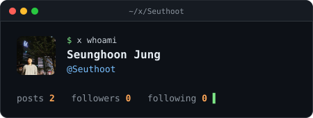
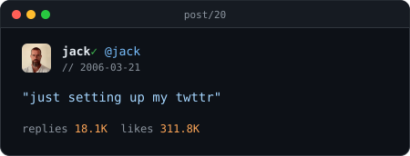
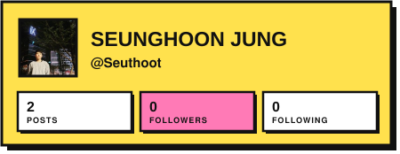
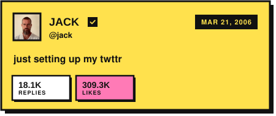
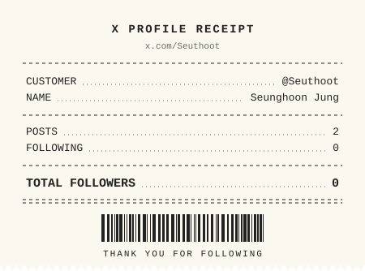
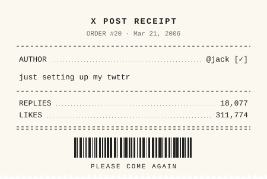

# readme-x-cards

X (Twitter) profile and post cards for your GitHub README. Free, no sign-up, no API key — just paste a URL.

| Aurora | Terminal |
|---|---|
|  |  |
|  |  |

| Paper | Brutal |
|---|---|
|  |  |
|  |  |

| Receipt | Sunset |
|---|---|
|  |  |
|  |  |

**Try it:** https://readme-x-cards.vercel.app/ — type your username, pick a theme, copy the snippet.

## Usage

### Profile card

```md
[](https://x.com/Seuthoot)
```

### Latest post (auto-updates)

```md
[](https://x.com/Seuthoot)
```

Want your three latest posts? Add three lines with `index=1`, `index=2`, `index=3`.

### A specific post

```md
[](https://x.com/jack/status/20)
```

## Options

| Endpoint | Parameter | Values | Default |
|---|---|---|---|
| `/api/profile` | `user` | X username (letters, digits, `_`, max 15) | required |
| `/api/post` | `id` | Post ID (the number in the post URL) | — |
| `/api/post` | `user` | X username — shows their latest post | — |
| `/api/post` | `index` | `1`–`10`, n-th latest post (with `user`) | `1` |
| both | `theme` | `aurora`, `terminal`, `paper`, `brutal`, `receipt`, `sunset` | `aurora` |

`/api/post` needs either `id` or `user`; `id` wins if both are given.

## How fresh is the data?

Cards are cached: profiles for 6 hours, latest posts for 1 hour, specific posts for 24 hours. GitHub also caches README images, so changes can take a little longer to show up.

## Deploy your own

[](https://vercel.com/new/clone?repository-url=https%3A%2F%2Fgithub.com%2FseuthootDev%2Freadme-x-cards)

No environment variables needed. Running your own instance keeps your cards working even if the public one is rate-limited.

Optional: connect an [Upstash Redis](https://vercel.com/marketplace/upstash) database to the project (it sets `KV_REST_API_URL` / `KV_REST_API_TOKEN` or `UPSTASH_REDIS_REST_URL` / `UPSTASH_REDIS_REST_TOKEN`). Each card then remembers its last successful data for 7 days, and when X data is briefly unavailable it shows that instead of an error card.

## Adding a theme

1. Create `src/themes/<name>.ts` exporting an object that implements `Theme` (`src/themes/types.ts`): `renderProfile`, `renderPost`, `renderError`, each returning a complete SVG string.
2. Register it in `src/themes/index.ts`.
3. Add it to the `describe.each` list in `tests/theme-contract.test.ts` (plus any theme-specific checks) and run `npm test`, then `npm run smoke` to render previews.

Rules: card width 450px, escape every external string with `escapeXml`, never reference external URLs (GitHub blocks them inside SVG images — avatars arrive as data URIs).

## Development

```bash
npm install
npm test          # unit tests, no network
npm run typecheck
npm run smoke     # renders real cards into docs/previews (uses the network)
npx vercel dev    # local server at http://localhost:3000
```

## Disclaimer

This project does not use the official X API. Data comes from unofficial public endpoints (X's embed syndication service and [FxEmbed/fxtwitter](https://github.com/FxEmbed/FxEmbed)), which may change or stop working at any time. Not affiliated with or endorsed by X Corp.

## License

MIT
